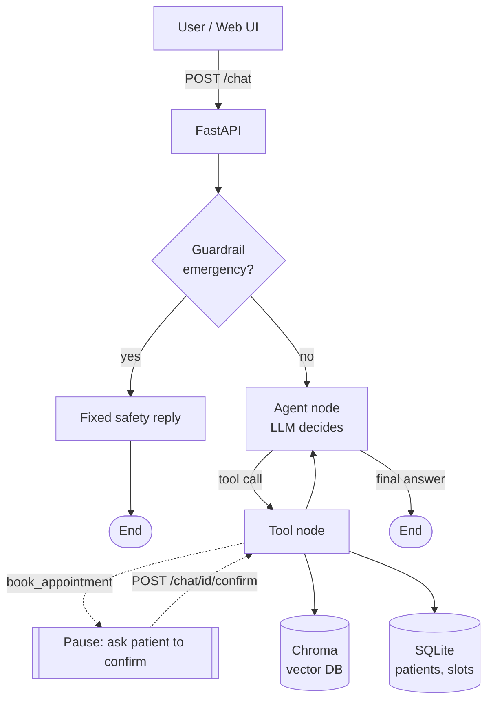

# Clinic Front-Desk AI Agent

An AI agent that handles a clinic's front desk: it answers questions from the clinic's own documents (RAG), registers patients, checks doctor availability and books appointments, while **asking the patient to confirm before anything is saved** and **refusing to handle emergencies or give medical advice**.

Built with **LangGraph, LangChain, FastAPI, Chroma (vector database) and SQLite**, with Gemini or OpenAI as the LLM.

> All clinic data in this repo is fictional sample data.

## What it does

| Capability | How |
| --- | --- |
| Answers clinic questions with sources | RAG: documents are chunked, embedded and stored in **Chroma**; the agent retrieves the most relevant passages and cites the source file |
| Registers patients | Tool call with server-side validation (Pakistani mobile format, real date of birth) and **duplicate detection** by phone |
| Finds free slots and books | Tool calls against SQLite; bookings are atomic, so a slot can never be double-booked |
| Asks before acting | **Human-in-the-loop**: the workflow pauses (`interrupt`) until the patient approves the booking |
| Remembers the conversation | **Checkpointer memory** per `thread_id`; separate conversations never share memory |
| Stays safe | **Guardrails**: emergencies get a fixed safety message before the LLM is called; the prompt forbids diagnosis; invalid tool arguments are rejected field by field |

## Architecture



The agent follows the **ReAct pattern**: the LLM reasons, calls a tool, reads the result, and repeats until it can answer. LangGraph orchestrates this as a state graph with conditional edges, and the checkpointer saves the state after every step, which is what makes both memory and pause-and-resume possible.

### Document pipeline (ETL)
`python -m app.knowledge` **extracts** the clinic's Markdown files, **transforms** them into overlapping chunks and embeddings, and **loads** them into Chroma with content-based IDs, so re-running the pipeline is **idempotent** (no duplicates).

## Tech stack

| Layer | Technology |
| --- | --- |
| Agent orchestration | LangGraph (`StateGraph`, `ToolNode`, `interrupt`, `InMemorySaver`) |
| LLM interface | LangChain chat models: Gemini (`gemini-3.1-flash-lite`, set with `GEMINI_MODEL`) or OpenAI (`gpt-4o-mini`) |
| RAG | `RecursiveCharacterTextSplitter`, Chroma, Gemini/OpenAI embeddings (or an offline keyword embedding) |
| API | FastAPI + Pydantic |
| Data | SQLite (plain SQL: joins, transactions, unique constraints) |
| Quality | pytest (41 tests with a scripted fake LLM, so no API key needed), GitHub Actions CI, retrieval evaluation |
| Deployment | Docker |


## Multi-agent mode

Set `AGENT_MODE=multi` in `.env` to switch from one agent to a **supervisor + two specialists** (`app/multi_agent.py`):

```
guardrail -> supervisor -> info_agent    <-> info_tools      (search_clinic_info only)
                       \-> booking_agent <-> booking_tools   (find / register / slots / book, with confirmation)
```

The supervisor makes one small LLM call ("info" or "booking"); each specialist has its own short prompt and only the tools it needs. `/chat` then also returns `handled_by`. Trade-off: fewer wrong tool calls per specialist, one extra LLM call per message. Memory, guardrails and the booking confirmation pause work the same in both modes (5 extra tests).

`examples/openai_agents_demo.py` rebuilds the same idea with the OpenAI Agents SDK (handoffs instead of graph edges) for comparison.

## Run it

```bash
python -m venv .venv && source .venv/bin/activate     # Windows: .venv\Scripts\activate
pip install -r requirements.txt
cp .env.example .env                                   # then add your GOOGLE_API_KEY (or OPENAI_API_KEY)
uvicorn app.api:app --reload
```
Open **http://localhost:8000** for the chat page, or **http://localhost:8000/docs** for the interactive API docs.

With Docker:
```bash
docker build -t clinic-agent .
docker run -p 8000:8000 --env-file .env clinic-agent
```

## API

| Method | Path | Purpose |
| --- | --- | --- |
| `POST` | `/chat` | `{"message": "...", "thread_id": "optional"}` → reply, thread id, and any pending confirmation |
| `POST` | `/chat/{thread_id}/confirm` | `{"approved": true}` answers a pending booking (404 if none) |
| `POST` | `/ingest` | Re-run the document pipeline |
| `GET` | `/health` | Liveness check |

While a booking is waiting for confirmation, new messages on that thread return **409 Conflict**.

## Tests and evaluation

```bash
pytest                          # 41 tests, no API key needed
python -m evals.retrieval_eval  # retrieval accuracy on 15 labelled questions
```

Retrieval results with the **offline keyword embeddings** (`EMBEDDINGS_PROVIDER=local`):

| Metric | Result |
| --- | --- |
| Hit@1 (right document ranked first) | 13/15 = 87% |
| Hit@3 (right document in top 3) | 14/15 = 93% |
| Off-topic questions refused | 2/3 |

Run the same evaluation with `EMBEDDINGS_PROVIDER=gemini` to compare against semantic embeddings.

The agent tests cover: the ReAct tool loop, emergencies never reaching the LLM, booking only after approval, declined bookings saving nothing, per-thread memory, and API status codes.

## Project structure

```
app/
  agent.py       LangGraph workflow + service wrapper
  tools.py       the agent's tools (search, find, register, slots, book)
  guardrails.py  emergency detection + input validation
  knowledge.py   ETL pipeline + retriever (Chroma)
  embeddings.py  embedding providers (local / Gemini / OpenAI)
  llm.py         chat model provider
  db.py          SQLite schema and queries
  api.py         FastAPI endpoints
  prompts.py     system prompt
data/clinic_docs/  sample knowledge base
evals/           retrieval evaluation
tests/           pytest suite
static/          demo chat page
```

## Limitations and next steps
- Memory is in-process (`InMemorySaver`); production would use a persistent checkpointer such as PostgreSQL.
- The emergency guardrail is keyword-based; a classifier would catch more phrasings.
- Next: authentication, cancelling and rescheduling tools, SMS reminders, and an LLM-graded answer-quality evaluation.
